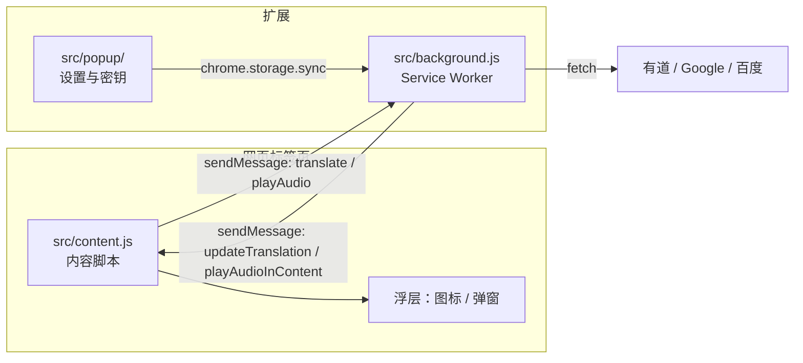
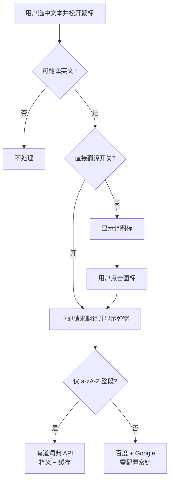

# 英文到中文翻译插件（Chrome Extension）

在浏览器网页中选中文本，即可查词或翻译为简体中文。扩展基于 **Manifest V3**，由**内容脚本**（页面交互与浮层）、**后台 Service Worker**（网络请求与缓存）和**弹出页**（设置）协作完成。

---

## 项目概要

| 项目 | 说明 |
|------|------|
| **名称** | 英文到中文翻译插件 |
| **版本** | 1.2.0（见 `manifest.json`） |
| **目标** | 在任意网页选择英文内容，展示词典释义（单词）或机器翻译（短语/句子） |
| **输出语言** | 简体中文（词典释义来自有道接口结构；机器翻译为 `zh` / `zh-CN`） |

本仓库为**无构建步骤**的扩展：HTML/CSS/原生 JavaScript，无 React、Vue 等前端框架。

---

## 功能概览

- **选区触发**：鼠标松开后，若选中文本被判定为「可翻译的英文」，则出现「译」悬浮按钮，或（可选）直接弹出结果。
- **纯英文单词**（仅字母）：通过有道 JSON 接口拉取释义、词形变化、同根词、同义词、例句、常见搭配（含搭配译文）；支持英/美音切换与发音（音频经后台拉取后由页面用 Web Audio 播放）。
- **非纯词形式**（含空格、标点等）：走 **百度翻译** 与 **Google Cloud Translation API v2**（需在弹出页配置密钥），展示「原文内容卡片 + 各引擎独立结果块」。
- **开关**：可在弹出页关闭整站翻译、或开启「直接显示翻译结果」（跳过「译」按钮）。

---

## 架构与数据流



**翻译请求分支（逻辑概要）：**



---

## 使用方法

### 安装（开发者模式）

1. 打开 Chrome，地址栏输入 `chrome://extensions/`。
2. 打开右上角 **开发者模式**。
3. 点击 **加载已解压的扩展程序**，选择本仓库根目录（含 `manifest.json` 的文件夹）。

### 在网页中使用

1. 确保扩展已启用，且弹出页中 **「启用翻译功能」** 为开启（默认开启）。
2. 用鼠标在页面上**拖选**一段英文（单词、短语或句子均可）。
3. **松开鼠标**后：
   - 默认：选区附近出现 **「译」** 小按钮，点击后发起翻译/查词。
   - 若开启 **「直接显示翻译结果」**：松手后直接弹出结果浮层，无需再点「译」。
4. 结果浮层可**拖动**，并会自动约束在可视区域内（避免超出屏幕）；点击浮层外的页面区域可关闭（等待结果过程中为避免误关有特殊判断）。
5. 单词结果中可切换英/美音按钮、「查看更多」跳转有道网页；完整结果返回后会按偏好**自动播放**一次读音。

### 各模式说明

| 模式 | 行为 |
|------|------|
| 仅英文单词（`^[a-zA-Z]+$`） | 有道词典 JSON，失败时回退为百度+Google 翻译说明 |
| 短语/句子 | 需配置 API：同时尝试百度与 Google，未配置的引擎会显示提示文案；每个翻译引擎单独一个结果区块 |
| 排除规则 | 纯数字、中文、常见 URL/路径形态等不会被当作可翻译文本（见 `src/content.js` 中 `isTranslateable`） |

---

## 配置方法

### 弹出页设置

点击浏览器工具栏中的扩展图标，打开弹出页：

| 配置项 | 存储键 | 说明 |
|--------|--------|------|
| 启用翻译功能 | `isEnabled` | 关闭后不再显示图标/结果，并清理当前页浮层 |
| 直接显示翻译结果 | `directTranslate` | 选区松手后直接弹层，不经过「译」按钮 |
| Google API Key | `googleApiKey` | [Google Cloud Translation API](https://cloud.google.com/translate/docs) 的 API 密钥 |
| 百度翻译 App ID | `baiduAppId` | [百度翻译开放平台](https://fanyi-api.baidu.com/) 应用 ID |
| 百度翻译 Key | `baiduKey` | 同上应用密钥 |
| 音标偏好 | `phoneticPreference` | `us` / `uk`，在单词浮层内切换时写入 |

点击 **「保存以上密钥」** 后写入 `chrome.storage.sync`。至少需要配置 **Google Key** 或 **百度 App ID + Key** 中的一套，短语/句子翻译才会有对应引擎的结果。

### 获取第三方密钥（官方入口）

- **Google**：在 [Google Cloud Console](https://console.cloud.google.com/) 创建项目，启用 Cloud Translation API，创建 API 密钥并限制用途（建议限制 HTTP 引用来源或 IP，仅作说明，具体以 Google 文档为准）。
- **百度**：在 [百度翻译开放平台](https://fanyi-api.baidu.com/) 创建应用，获取 App ID 与密钥。

### 权限与网络

扩展在 `manifest.json` 中声明了 `activeTab`、`storage` 及多个 `host_permissions`，用于访问有道、Google、百度等接口。安装时浏览器会展示这些权限说明。

---

## 存储说明

| 存储 | 用途 |
|------|------|
| `chrome.storage.sync` | 用户设置与 API 密钥（可随 Chrome 同步，受配额限制） |
| `chrome.storage.local` | 单词释义缓存 `wordCache`（约 24 小时过期、最多约 100 词，含可选音频二进制缓存） |

---

## 项目结构（主要文件）

```
chrome-translation-extension/
├── manifest.json              # 扩展清单（入口指向 src/）
├── LICENSE
├── README.md
├── TechStack.md
└── src/
    ├── background.js            # Service Worker：翻译、缓存、音频
    ├── content.js             # 内容脚本：选区、浮层、消息
    ├── icons/                 # 工具栏图标（紫渐变「译」）
    ├── styles/
    │   └── content.css        # 注入页面的图标与弹层样式
    └── popup/
        ├── popup.html
        ├── popup.css          # 弹出页专用样式
        └── popup.js
```

| 路径 | 作用 |
|------|------|
| `manifest.json` | MV3 清单、权限、`src/` 下各入口 |
| `src/content.js` | 选区检测、图标/弹层 UI、与后台消息收发、音频播放解码 |
| `src/background.js` | 翻译路由、有道/百度/Google 请求、MD5 签名、缓存与音频拉取 |
| `src/popup/popup.html` · `popup.js` · `popup.css` | 设置界面与 `storage` 读写 |
| `src/styles/content.css` | 注入网页的 `.translate-icon` / `.translate-popup` 等 |

---

## 注意事项

- **安全**：勿将真实 API 密钥写入代码或提交到 Git；使用弹出页保存或本地环境变量（若日后接入构建流程）。
- **清单与权限**：当前 `host_permissions` 仅包含有道、Google、百度翻译所需域名；MD5 在 `src/background.js` 内联实现。
- **缓存策略**：单词缓存项包含 `templateVersion`，当模板升级时会自动淘汰旧缓存，避免旧结构/旧样式导致展示异常。
- **百度接口**：代码中使用 `http://api.fanyi.baidu.com/...`（明文 HTTP）。生产环境建议按百度官方文档改用 **HTTPS** 端点（若提供），并关注区域与配额限制。

---

## 许可证

见仓库根目录 `LICENSE` 文件。
