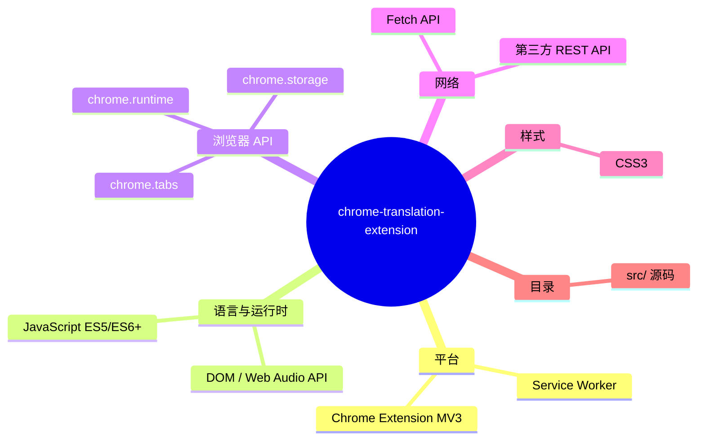
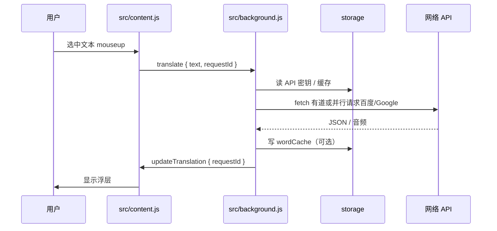
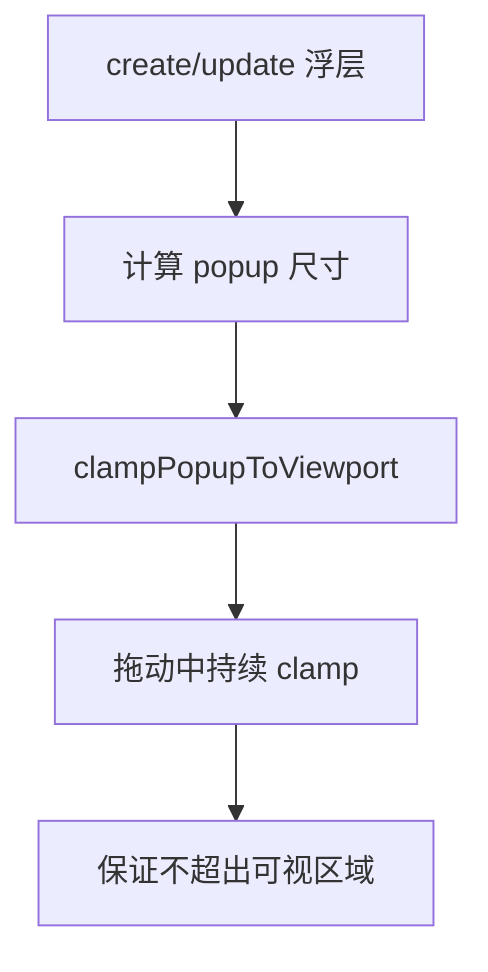

# 技术栈说明（Tech Stack）

本文档归纳本仓库**实际使用**的技术、官方文档入口，以及扩展开发中常用的 API 与命令。本扩展为 **Chrome 扩展 Manifest V3**，界面与逻辑均为 **原生 JavaScript**，**未使用** React、Vue、Webpack 等框架或打包工具。

---

## 总览



---

## 1. Chrome 扩展（Manifest V3）

**简介**：扩展由清单文件声明生命周期、权限、后台脚本、内容脚本与弹出页。MV3 使用 **Service Worker** 作为后台脚本（非持久后台页），适合事件驱动与网络代理类逻辑。

| 资源 | 地址 |
|------|------|
| 官方文档（Extensions） | https://developer.chrome.com/docs/extensions |
| Manifest V3 概述 | https://developer.chrome.com/docs/extensions/mv3/intro/ |
| Service Worker 说明 | https://developer.chrome.com/docs/extensions/mv3/service_workers/ |

**本项目中常见用法**：

| 能力 | 用途 |
|------|------|
| `manifest_version: 3` | 使用 MV3 清单格式 |
| `content_scripts` | 向 HTTP/HTTPS 页面注入 `src/content.js` 与 `src/styles/content.css` |
| `background.service_worker` | `src/background.js` 处理翻译与缓存 |
| `action.default_popup` | 工具栏图标打开 `src/popup/popup.html` |
| `permissions`：`storage` | 保存同步设置、本机密钥覆盖值与缓存 |
| `host_permissions` | 允许 `fetch` 访问有道、Google、百度等域名 |
| `chrome.runtime.sendMessage` / `onMessage` | 内容脚本 ⟷ 后台、弹出页 ⟷ 内容脚本 |

**常用调试方式**：

- 扩展页 `chrome://extensions/` → 「检查视图」可打开 **Service Worker** 的 DevTools（后台脚本）。
- 在网页上 F12 → **Console** 查看内容脚本日志。
- 弹出页右键 →「检查」调试 `src/popup/popup.js`。

---

## 2. JavaScript（原生）

**简介**：逻辑分布在 `src/content.js`、`src/background.js`、`src/popup/popup.js`，使用 `async/await`、`fetch`、Promise、`chrome.*` API 回调等。

| 资源 | 地址 |
|------|------|
| MDN JavaScript 指南 | https://developer.mozilla.org/zh-CN/docs/Web/JavaScript/Guide |
| MDN Fetch | https://developer.mozilla.org/zh-CN/docs/Web/API/Fetch_API |

**本项目中常见模式**：

```javascript
// 异步存储（Promise 封装示例）
new Promise((resolve) => {
  chrome.storage.local.get(['googleApiKey'], resolve);
});

// 跨上下文消息
chrome.runtime.sendMessage({ action: 'translate', text: 'hello', requestId: 1 });
chrome.runtime.onMessage.addListener((request, sender, sendResponse) => { /* ... */ });
```

---

## 3. HTML & CSS

**简介**：`src/popup/popup.html` 为弹出页结构，样式在 `popup.css`；`src/styles/content.css` 注入网页，控制 `.translate-icon`、`.translate-popup` 等。无 CSS 预处理器。结果浮层采用「外层限高 + 内层滚动」结构，并在 `src/content.js` 中执行视口内约束（clamp）。

| 资源 | 地址 |
|------|------|
| MDN HTML | https://developer.mozilla.org/zh-CN/docs/Web/HTML |
| MDN CSS | https://developer.mozilla.org/zh-CN/docs/Web/CSS |

---

## 4. Web Audio API

**简介**：后台拉取发音音频二进制后发给内容脚本，在页面用 `AudioContext.decodeAudioData` 解码并播放。

| 资源 | 地址 |
|------|------|
| MDN Web Audio API | https://developer.mozilla.org/zh-CN/docs/Web/API/Web_Audio_API |

---

## 5. Chrome `storage` API

**简介**：`chrome.storage.sync` 仅用于非敏感设置；`chrome.storage.local` 用于本机 API 密钥覆盖值与单词/音频缓存。

| 资源 | 地址 |
|------|------|
| chrome.storage | https://developer.chrome.com/docs/extensions/reference/storage/ |

**常用方法**：

- `chrome.storage.sync.get(keys, callback)`
- `chrome.storage.sync.set(object, callback)`
- `chrome.storage.local.get` / `set`（同上）
- `wordCache.templateVersion`（模板版本迁移时淘汰旧缓存）

---

## 6. Chrome `tabs` API

**简介**：后台向发起请求的标签页发送翻译和音频消息，始终沿用 `sender.tab.id`，避免用户切换标签页后把结果发送到错误页面。

| 资源 | 地址 |
|------|------|
| chrome.tabs | https://developer.chrome.com/docs/extensions/reference/tabs/ |

---

## 7. 第三方翻译与词典服务（HTTP API）

以下为代码中**实际请求**的服务（实现见 `src/background.js`）。

### 7.1 有道（网页词典 JSON）

**用途**：纯英文单词的释义、词形变化、同根词、同义词、例句、常见搭配（含译文）等 HTML 拼装；发音 URL 为 `dict.youdao.com/dictvoice`。

**说明**：非官方公开文档的固定 SDK，依赖 URL 与返回 JSON 结构；变更可能导致解析失败，届时需适配。

### 7.2 Google Cloud Translation API v2

**简介**：REST `POST`，`translation.googleapis.com/language/translate/v2`，请求体含 `q`、`source`、`target`、`format`。

| 资源 | 地址 |
|------|------|
| Cloud Translation 文档 | https://cloud.google.com/translate/docs |
| 基本快速入门 | https://cloud.google.com/translate/docs/basic/setup-basic |

**注意**：需在 Google Cloud 启用 API 并妥善保管 API Key。

### 7.3 百度翻译 API

**简介**：通用文本翻译；签名 `sign = MD5(appid + query + salt + secretKey)`，项目内使用 **内联 MD5 实现**（`src/background.js` 文件前部）。

| 资源 | 地址 |
|------|------|
| 百度翻译开放平台 | https://fanyi-api.baidu.com/ |

---

## 8. 未采用的技术（说明）

| 技术 | 说明 |
|------|------|
| **React / Vue / Svelte** | 本仓库无组件框架，弹出页为静态 HTML + 少量脚本 |
| **TypeScript** | 无 `.ts` 文件 |
| **Webpack / Vite / Rollup** | 无 `package.json` 构建链路 |
| **Node.js** | 扩展运行时不在 Node，仅开发者本机可选用 Node 做工具脚本 |

若将来用 React/Vue 重写弹出页，通常会增加构建步骤，并把产出物指向 `manifest` 中的 `default_popup` 或独立页面。

---

## 9. 开发与命令行（参考）

本仓库**无** npm 脚本。日常开发流程依赖 Chrome 与文件保存后刷新扩展：

1. 修改源码后，在 `chrome://extensions/` 点击该扩展的 **重新加载**。
2. 刷新正在测试的网页以使内容脚本更新。

可选命令（仅当本机使用 Git 时）：

```bash
git status
git diff
```

---

## 10. 相关流程简图（消息与存储）





---

*文档与仓库实现同步；若代码变更，请更新本节中的行为描述。*
